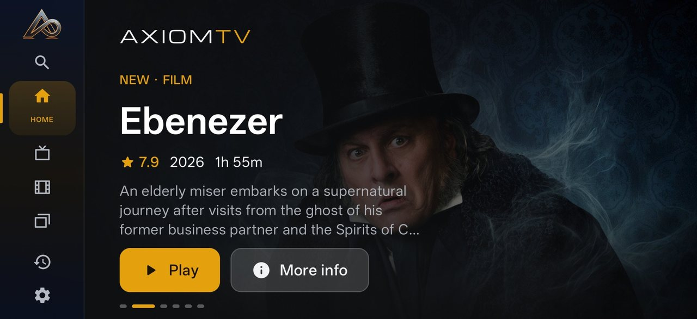
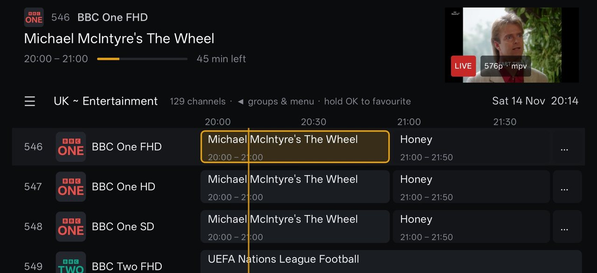
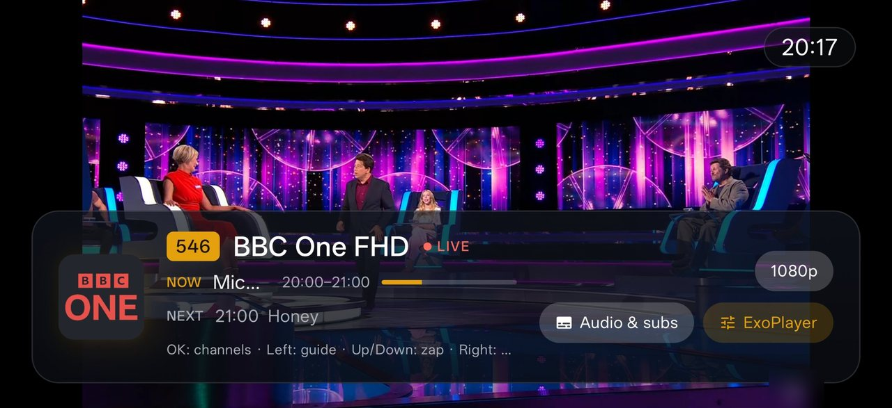
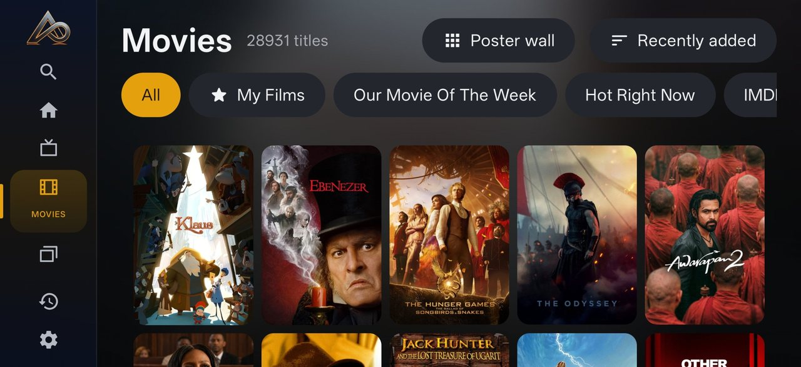
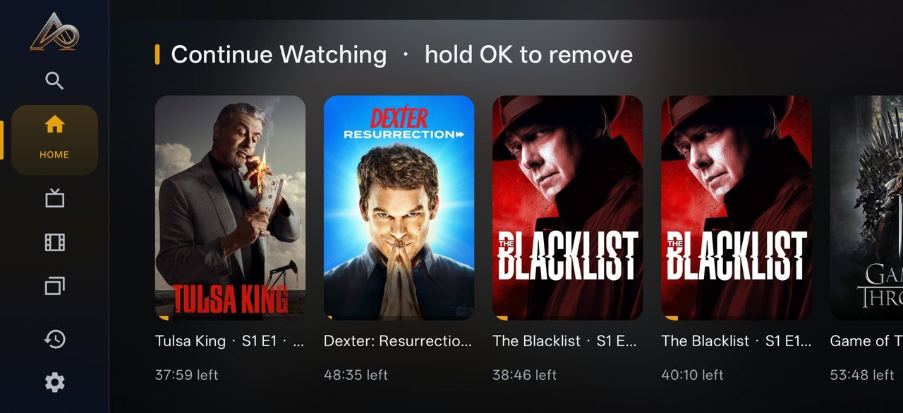
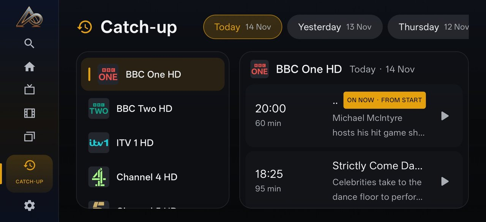
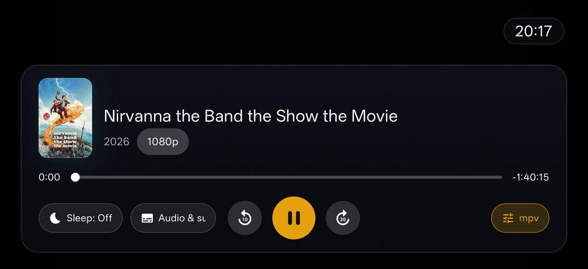
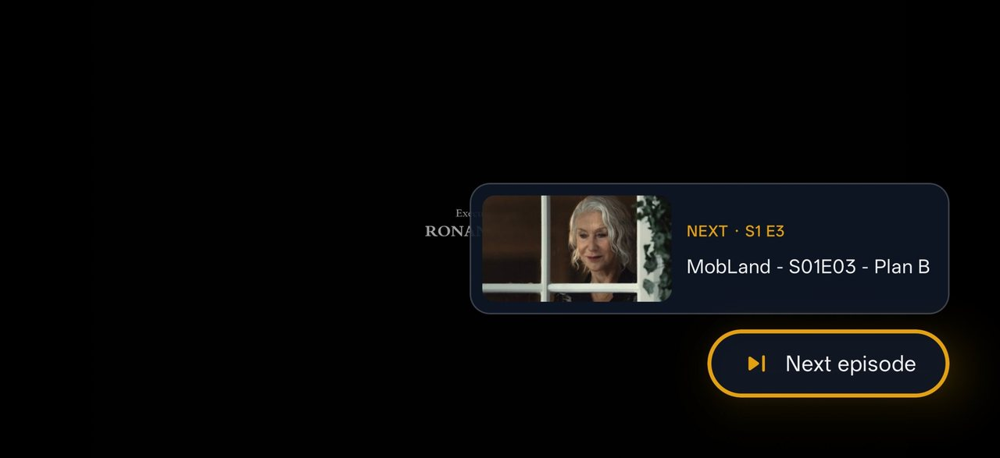

<p align="center">
  
</p>

<h1 align="center">AXIOM<span>TV</span></h1>

<p align="center">
  <b>A fast, good-looking IPTV player for Android TV devices and phones.</b><br>
  TiviMate-style live TV guide · Plex-style films &amp; series · hybrid ExoPlayer + mpv playback
</p>

<p align="center">
  <a href="https://axiomtv.co.uk"></a>
  <a href="https://get.axiomtv.co.uk"></a>
  <a href="https://discord.gg/kBzDNRnMys"></a>
  <br>
  <a href="https://github.com/FiTH-g1gGLe/AxiomTV/releases/latest"></a>
  <a href="https://github.com/FiTH-g1gGLe/AxiomTV/releases"></a>
  <a href="https://github.com/FiTH-g1gGLe/AxiomTV/releases/latest"></a>
  <br>
  <a href="https://github.com/FiTH-g1gGLe/AxiomTV/actions/workflows/build.yml"></a>
  
  
  
  <a href="LICENSE"></a>
  
</p>

<p align="center">
  <a href="https://github.com/FiTH-g1gGLe/AxiomTV/releases/latest/download/AxiomTV.apk"><b>⬇ Download AxiomTV.apk</b></a>
  &nbsp;·&nbsp; <a href="https://axiomtv.co.uk"><b>axiomtv.co.uk</b></a>
  <br><sub>3-day free trial, then one payment unlocks your device for life</sub>
</p>

<p align="center">
  
</p>

<table>
  <tr>
    <td width="50%"><br><sub><b>TV guide</b>, with the live preview window</sub></td>
    <td width="50%"><br><sub><b>Live TV</b>, frosted now &amp; next card</sub></td>
  </tr>
  <tr>
    <td><br><sub><b>Movies</b>, poster wall with categories</sub></td>
    <td><br><sub><b>Continue Watching</b> on Home</sub></td>
  </tr>
  <tr>
    <td><br><sub><b>Catch-up</b>, day tabs, channels &amp; programmes</sub></td>
    <td><br><sub><b>Film player</b>, matching frosted controls</sub></td>
  </tr>
  <tr>
    <td><br><sub><b>Skip intro</b>, from community skip times</sub></td>
    <td><br><sub><b>Next episode</b>, with picture and title</sub></td>
  </tr>
</table>

---

## 🆕 Latest additions

- **Free trial and lifetime unlock**: every device gets a **3-day free trial**. After that a payment screen shows a QR code and the device's own code; pay once on your phone and the device unlocks by itself, for life.
- **Move to a new device yourself**: get a 6-digit code on the old device and type it on the new one, or use your receipt if the old device is lost.
- **New website**: [axiomtv.co.uk](https://axiomtv.co.uk), with install steps, FAQ and the short download address **get.axiomtv.co.uk**.
- **Next episode button** with the episode's picture and title, plus **Skip intro** and **Skip recap**.
- **Community skip times** from TheIntroDB and IntroDB, or mark a show's intro yourself.
- **Next season** carries straight on into the next season when one ends.
- **Steadier streams**: automatic reconnects, better handling of slow or patchy servers, and our own player libraries.
- **Catch-up** section with day tabs, and one shared menu bar across the whole app.

---

## What is AxiomTV?

AxiomTV is an IPTV player built for the living room. Sign in with your provider's **Xtream Codes** login and you get:

- a **lightning-fast TV guide** in the style of TiviMate,
- a **Plex / Apple TV-style library** for films and series, with artwork, ratings, cast and trailers,
- and a **hybrid playback engine** that picks the best player for every stream and switches automatically if one struggles.

It is designed for the TV remote first (every screen works with just the arrows, OK and Back), and it works on phones too.

> AxiomTV doesn't come with any channels or content. You need your own subscription from an IPTV provider.

---

## Pricing

| | |
|---|---|
| **Free trial** | 3 days with every feature, no card needed |
| **Lifetime unlock** | **£7.99** one-off (early bird price), per device, with all future updates |
| **Changed device?** | Move your unlock yourself once every 30 days, or ask us |

Payments are handled securely by Lemon Squeezy. See the [refund policy](https://axiomtv.co.uk/refunds.html).

---

## Features

### 📺 Live TV
- **TiviMate-style guide** with a live preview window, and a collapsible menu: channel groups first, then the main menu further left.
- **Now & next info bar** in a floating frosted-glass card: channel logo, gold channel number, red LIVE dot, programme progress and what's on next.
- **Channel strip** (press OK) showing now and next on nearby channels.
- **Fast zapping**: channels start after about one second of video, and pressing Up/Down quickly only tunes the channel you stop on.
- **Favourites**: hold OK on a channel to add it to Favourites.
- **Channel groups**: hide the groups you never watch and put your favourite ones at the top.
- **Start-up group**: hold OK on a group and Live TV always opens on it, marked with a pin.
- Provider TV guide by default, or add your own **XMLTV link**.

### ⏪ Catch-up
- A dedicated **Catch-up** section: day tabs along the top, channels on the left, programmes on the right.
- Watch anything from the **last 3 days** on channels that support it. Programmes still on air can be watched **from the start**.
- Past programmes in the TV guide show a rewind icon and play straight away.

### 🎬 Films & Series
- **Five layouts** for Movies and Series: poster wall (the default), posters, large posters, wide cards and list.
- **Five episode layouts**: list (the default), cards, large cards, grid and compact.
- Rich detail pages using **TMDB**: backdrop, rating, age rating, runtime, cast and director.
- **Trailers**: opens the trailer in the YouTube app.
- **My Films / My Series** favourites.
- **Series tracking**: watched ticks, a "next episode" button, and hold OK on an episode to mark it watched.
- **Skip intro, Skip recap & Next episode**: times come from chapters in the file, then the community databases [TheIntroDB](https://theintrodb.org) and [IntroDB](https://introdb.app), or an intro you mark yourself once per show. When the credits start, the next episode (or next season) plays by itself.
- Duplicate episodes from the provider are cleaned up automatically.

### 🏠 Home
- A **moving banner** of new releases, with slow zoom artwork and dots showing which one you're on.
- **Continue Watching**, which resumes exactly where you stopped and queues up the next episode.
- **Recently Watched Channels** and **Favourite Channels**.
- Hold OK on a Home tile to remove it or mark it watched.

### ▶️ Playback
- **Hybrid engine**: ExoPlayer for live TV, mpv for films and episodes.
- **Auto-switch**: if a stream doesn't start within a few seconds (4, 8 or 15 s, your choice) the app tries the other player and remembers what worked.
- Choose audio tracks and subtitles, pin an engine per stream, or forget all engine choices.
- **Sleep timer**: off, 30, 60, 90 or 120 minutes.
- **Next episode button** near the end of every episode, with the next episode's picture and title. It becomes **Next season** at the end of a season and **Back to series** at the very end.
- **Skip intro** and **Skip recap** buttons, using chapters in the file, the TheIntroDB and IntroDB community databases, or an intro you mark yourself with **Mark intro**.
- When the credits start the next episode **plays by itself** after a 10-second countdown (press Back to stay).
- **Stream recovery**: if a connection drops mid-film or mid-channel, AxiomTV reconnects on its own, up to three times, before trying the other player.
- Tuned for IPTV: faster starts, bigger buffers for films, and support for awkward live streams that other players stutter on.
- The film player matches the Live TV design: frosted card, glowing gold progress bar, clock in the corner.

### ✨ Look & feel
- **Navy frosted-glass menu bar**: icons only, a gold edge marker and a label under the current item. The same bar is used in the TV guide.
- **Artwork backgrounds**: a soft blurred copy of whatever you've selected sets the mood behind every screen.
- **Glow focus**: the selected poster lifts with a gold ring and glow, and film pages glow in each film's own colour.
- AxiomTV logo and **Michroma** wordmark.

### 🔐 Sign-in & setup
- **Sign in with your phone**: the TV shows a QR code and a 4-digit code, and you type your login on your phone. Details go straight from your phone to the device over your home Wi-Fi, with no accounts and no cloud.
- On the TV keyboard, fields only open the keyboard when you press OK.
- Show/hide password button.

### 🔓 Trial & unlocking
- **3-day free trial** on every device, with a short "free trial, X days left" note when the app opens.
- **Payment screen** with a QR code to pay on your phone, the device's code in big tiles, and a green light that unlocks the screen by itself once you've paid.
- **Already paid?** Move your unlock from your old device with a 6-digit code, or with the email and order number from your receipt.
- **Settings → Licence** shows your device code and status, and lets you move your unlock to another device.
- Unlocked devices keep working **offline for at least 30 days**; the licence is digitally signed so it can't be faked.

### 🧰 Everything else
- **Backup & restore** your favourites, watch progress, channel groups and settings to a file (never your login).
- **Automatic updates**: AxiomTV tells you when a new version is out and installs it for you.
- Works with the remote, a touch screen, or both.

---

## Install

### Android TV device / Google TV / Fire TV
1. Install the **Downloader** app from your device's app store.
2. Enter this address:
   ```
   get.axiomtv.co.uk
   ```
   (Download not starting? Use the backup address `download.axiomtv.co.uk`, or the full GitHub link
   `https://github.com/FiTH-g1gGLe/AxiomTV/releases/latest/download/AxiomTV.apk`.)
3. Install it, allowing installs from unknown sources if asked.

### Android phone or tablet
Open [get.axiomtv.co.uk](https://get.axiomtv.co.uk) (or the [latest release](https://github.com/FiTH-g1gGLe/AxiomTV/releases/latest)) on your phone and open the downloaded **AxiomTV.apk**.

After that, AxiomTV updates itself: when a new version is ready it shows an update card on start-up.

---

## Remote cheat sheet

| Where | Button | What it does |
|---|---|---|
| Live TV (full screen) | **OK** | Channel strip with now & next |
| | **Up / Down** | Change channel |
| | **Left** or **Back** | Open the TV guide |
| | **Right** | Engine menu & sleep timer |
| | **Menu** | Audio & subtitles |
| TV guide | **Hold OK** on a channel | Add/remove favourite |
| | **Left** | Channel groups, then the main menu |
| | **Hold OK** on a group | Make Live TV open on that group |
| Films & series | **Hold OK** on an episode | Mark watched / unwatched |
| Watching an episode | **OK** when a button shows | Skip intro / recap, or play the next episode |
| | **Back** when a button shows | Hide it (and stop the auto-play countdown) |
| Home | **Hold OK** on a tile | Remove from row / mark watched |
| Home | **Back** twice | Exit the app |

---

## Privacy

- Your provider login is stored **only on your device**. It is never sent anywhere except to your provider.
- Phone sign-in happens **directly over your home Wi-Fi**: nothing goes through a server.
- Backups never contain your login.
- To run the free trial and unlock, the app sends our licence server a **scrambled** device ID (never the real one), the device model and the app version. Buyers' email and order number come from Lemon Squeezy. Full details in the [privacy policy](https://axiomtv.co.uk/privacy.html).

---

## Built with

Kotlin · Jetpack Compose (Material 3) · Media3 ExoPlayer · libmpv · FFmpeg · Room · Hilt · Coil · TMDB API · TheIntroDB · ZXing

AxiomTV compiles its **own native playback libraries** (libmpv with FFmpeg, libass, libplacebo and dav1d, plus the Media3
FFmpeg and AV1 decoders) in the [native](native/) folder, using the *Build native libraries* workflow. New app versions are
built and published automatically by GitHub Actions on every change.

The licence server ([licence-server](licence-server/)) and the website ([website](website/)) run on Cloudflare Workers and are
deployed by GitHub Actions too.

---

## Help

Join the [AxiomTV Discord](https://discord.gg/kBzDNRnMys) (**discord.axiomtv.co.uk**) and post in the help forum with your device code (Settings → Licence). Link your device with Settings → Licence → Link Discord to get your roles.

---

## Credits

AxiomTV started as a fork of **[Wholphin](https://github.com/damontecres/Wholphin)** by damontecres, an open-source Android TV client for Jellyfin. Its mpv integration and native build scripts ([wholphin-extensions](https://github.com/damontecres/wholphin-extensions)), themselves adapted from [mpv-android](https://github.com/mpv-android/mpv-android), made the hybrid engine possible. Many thanks.

Film and series information and artwork come from [TMDB](https://www.themoviedb.org/). AxiomTV uses the TMDB API but is not endorsed or certified by TMDB.

Skip intro, recap and credits times come from the communities behind [TheIntroDB](https://theintrodb.org) and [IntroDB](https://introdb.app).

The Michroma font is used under the SIL Open Font License.

## Licence

- **The app** (everything except the two folders below) is released under the **GNU General Public License v2.0**, the
  same as Wholphin. See [LICENSE](LICENSE).
- **The licence server** ([licence-server](licence-server/)) and **the website** ([website](website/)) are separate
  programs and are **all rights reserved**. See the LICENSE file in each folder.
- **The AxiomTV name and logo** are trademarks. Forks must use their own name and logo. See [TRADEMARKS.md](TRADEMARKS.md).
